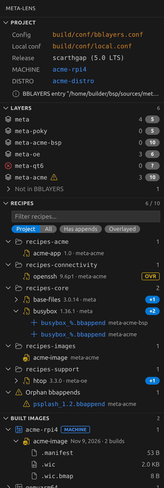
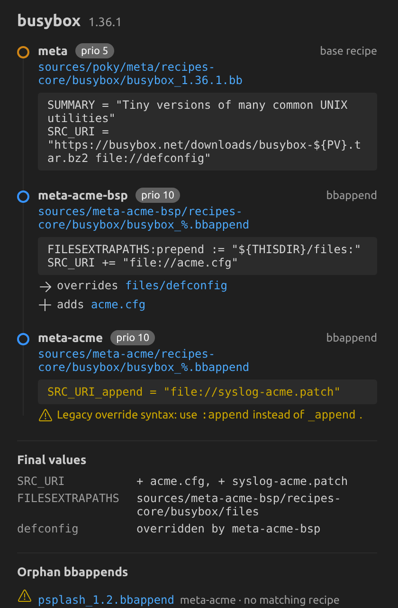

# meta-lens

**Understand any Yocto repo in minutes: layers, recipes, bbappends and overlay chains, right in VS Code.**

meta-lens maps a Yocto / OpenEmbedded project as soon as you open it. It only reads files:
no sourced `oe-init-build-env`, no bitbake run, no Python. It works right after a `git clone`.

> Status: **0.1.0 pre-release**, for early testers. Feedback welcome in the
> [issues](https://github.com/oliviertanoh/meta-lens/issues).

<p>
  
  
</p>

## Features

- **Project**: where the layers come from (`bblayers.conf` or kas file), `local.conf`,
  Yocto release, MACHINE and DISTRO with a link to their definition.
- **Layers**: BBLAYERS order, priority, recipe count and warnings. Click a layer to see its
  recipes. Layers checked out but missing from BBLAYERS are listed separately.
- **Recipes**: by default only the recipes your layers create or extend. Switch to all
  recipes, or filter on recipes with bbappends or overlayed recipes (same name in several
  layers, with the one BitBake uses).
- **Overlay chain**: click a recipe with bbappends to see, next to the editor, the base
  recipe then each bbappend in BitBake's order, the files they override through
  `FILESEXTRAPATHS` and the final `SRC_URI` additions.
- **Built images**: what is already in `tmp/deploy/images/<machine>/`, per machine.
- **Live**: updates on its own when a `.bb`, `.bbappend`, `.conf` or kas file changes, and
  after a build. Light: a few MB of memory, no background process.

## Install (pre-release)

1. Download `meta-lens-0.1.0.vsix` from the
   [releases page](https://github.com/oliviertanoh/meta-lens/releases).
2. In VS Code: Extensions view, `...` menu, **Install from VSIX...**, or:
   ```bash
   code --install-extension meta-lens-0.1.0.vsix
   ```
3. Open a Yocto project folder. meta-lens opens in the Secondary Side Bar (right). Use the
   logo in the editor title bar to bring it back.

Requires VS Code 1.90 or later; the panel lives on the right from VS Code 1.106, on the
left before that.

## Settings

| Setting | Default | |
|---|---|---|
| `metaLens.location` | `right` | `left` puts the panel in the Activity Bar |
| `metaLens.projectLayers` | `[]` | Layer names that are yours, when the automatic guess is wrong |
| `metaLens.excludeDirs` | `[]` | Extra folders to skip while scanning |
| `metaLens.showEditorButton` | `true` | Logo button in the editor title bar |

## Known limitations

- kas files are detected but not parsed yet: layers are found by scanning the folder.
- `BBMASK`, `PREFERRED_VERSION` and `PREFERRED_PROVIDER` are not read.
- Inline Python (`${@...}`) is evaluated only for the common `os.path` idioms.
- Tested on Linux so far.

## Development

```bash
npm install
npm run watch       # rebuild on change, then F5 in VS Code
npm run check       # typecheck, lint, format, unit tests
npm run test:e2e    # VS Code integration tests (downloads VS Code once)
npx @vscode/vsce package
```

## License

MIT
